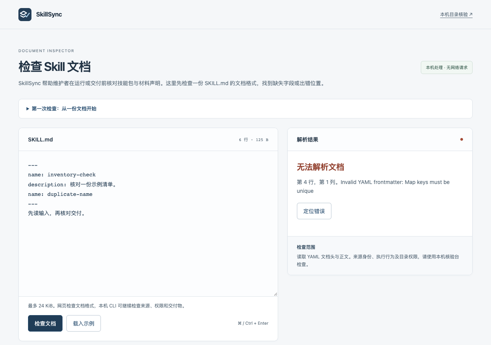

# SkillSync

[](https://github.com/Chumaniac/skillsync/actions/workflows/skillsync.yml) [](LICENSE)

在运行 Skill 之前，检查它来自哪里、需要哪些权限，以及交付物是否满足声明的规则。

**[打开 SKILL.md 检查器 →](https://chumaniac.github.io/skillsync/)** · [English / CLI reference](README.en.md) · [桌面下载](https://github.com/Chumaniac/skillsync/releases/tag/user-2026.11.11-zh)

进入后，点击「载入示例」再检查文档；出现行列提示时，用「定位错误」回到原文。网页只解析粘贴的文档，本机目录、权限和交付物由 CLI 核验。

[](https://chumaniac.github.io/skillsync/)

*合成文档的重复字段提示。点击截图可载入自己的示例。*


在线页的“第一次检查”从示例文档走到解析结果。本机工作台的页内引导分别定位单份核验、批量计划与历史记录；切换入口不会自动运行检查或批准修复。

## 快速开始

CLI 支持 Node.js 20 及以上版本。下面使用 Node.js 24 和 npm，在示例目录做一次只读检查。桌面打包所需的运行时见[构建说明](docs/build.md)。

```sh
git clone https://github.com/Chumaniac/skillsync.git
cd skillsync
npm ci
npm run build
node dist/cli/index.js verify --path fixtures/product/trust-loop/review --target codex
```

## 工作台

- **检查目录**。查看结构、来源、兼容性与具体问题，按报告中的路径定位文件。
- **复核交付**。对照声明检查文件、列和跨文件关系，区分失败、警告和证据不足。
- **保存与比较**。把报告留在自己的状态目录，比较前后两次检查并导出 JSON、HTML、JUnit 或 SARIF。

运行 `node dist/cli/index.js gui` 打开本机界面。修复前可查看计划，确认后再应用。默认未启用真实执行。

网页检查会标出 YAML 语法错误所在的行和列。点击「定位错误」可回到原文修正，继续编辑会清除上一次的位置。

## 常见问题

**网页能检查本机目录吗？** 网页只解析粘贴的文档。完整的目录、权限和交付物检查由本机 CLI 读取文件。

**需要 API Key 吗？** 离线核验无需环境变量或密钥。运行 `gui --state-dir <目录>` 可指定报告存储位置。

[使用指南](docs/user-guide.md) · [构建桌面应用](docs/build.md) · [隐私与备份](docs/privacy.md) · [贡献指南](CONTRIBUTING.md)

修复前的持久备份、并发编辑保全和中断后的核对步骤见[修复与恢复](docs/repair-recovery.md)。工作台会区分完成历史和保留的未完成材料。
